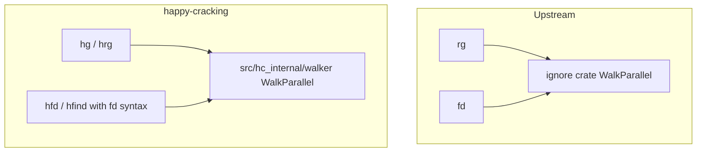
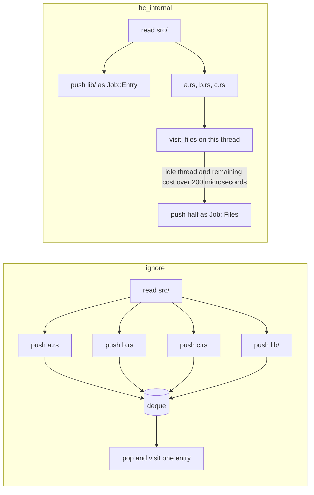
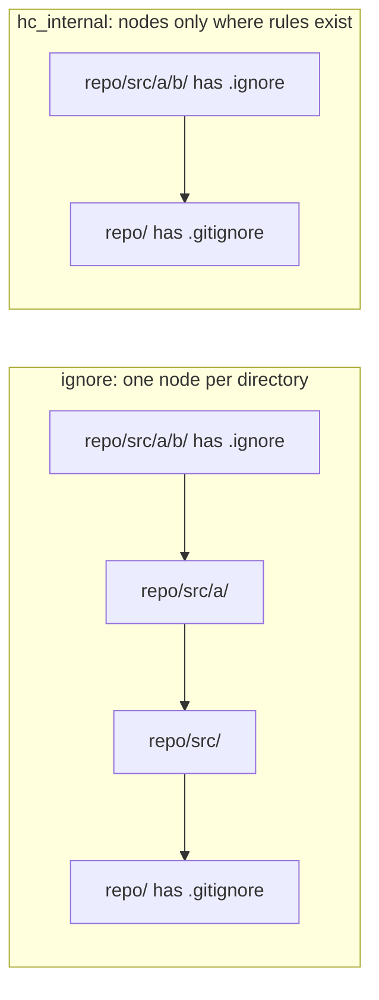
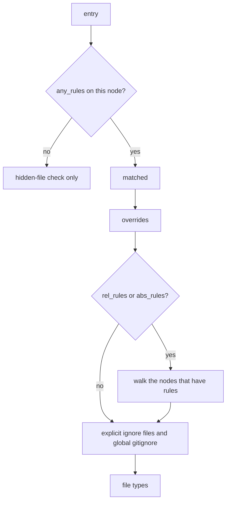
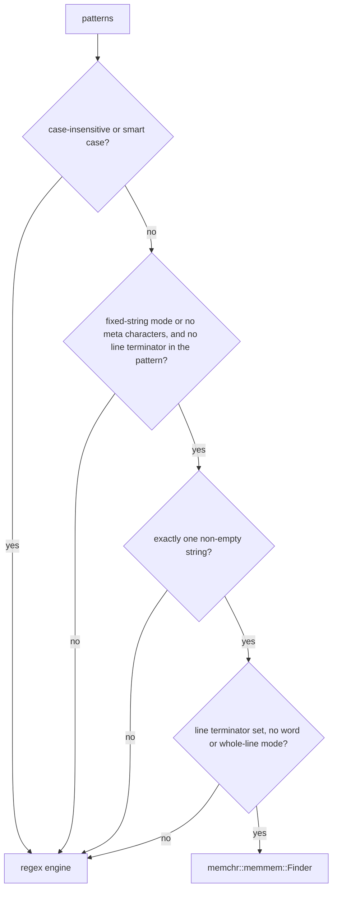
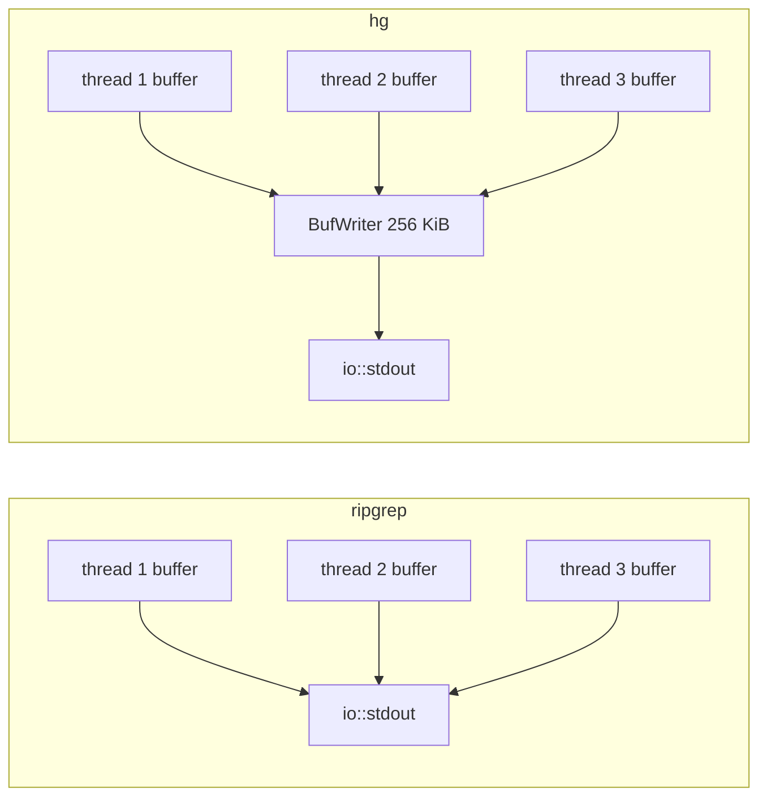
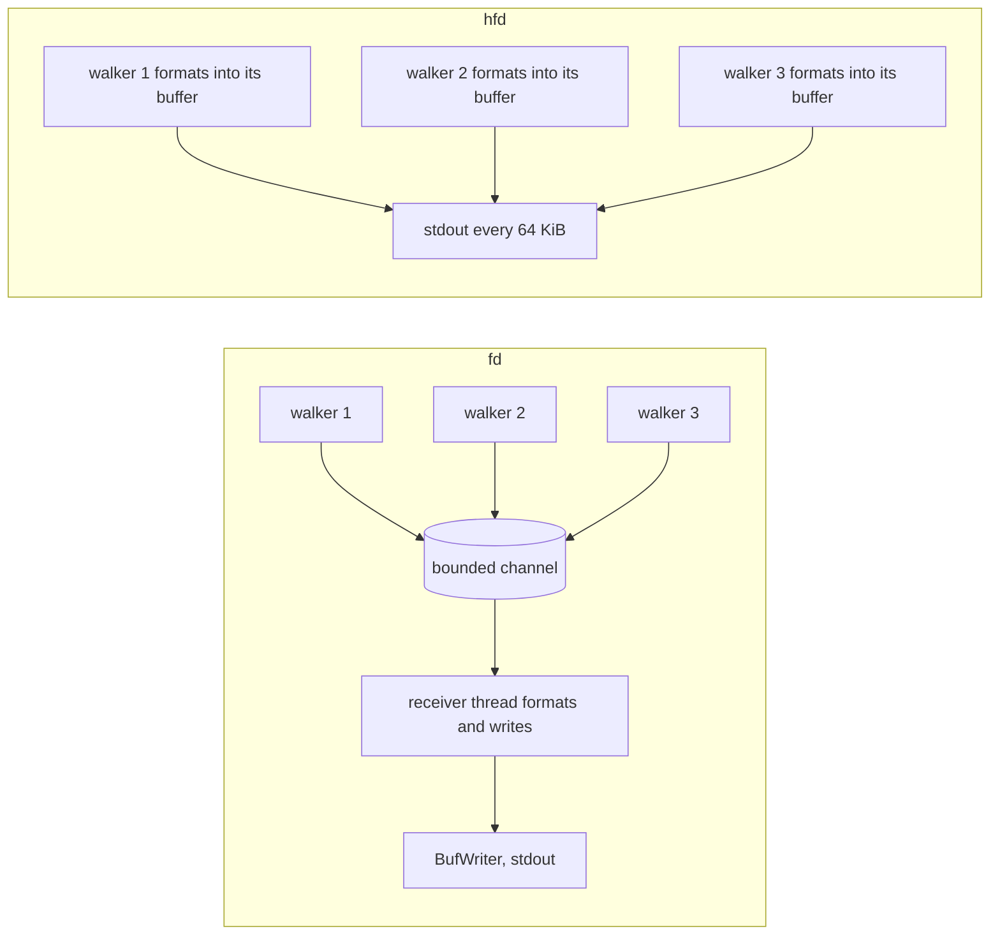

# Why hgrep and hfind outrun ripgrep and fd

`hg` and `hrg`, the ripgrep forms of `hgrep`, and `hfd`, the fd form of `hfind` that `hfind` also switches to when given an fd command line, do the same job as ripgrep and fd.
Most of the work they skip sits in one place: neither of them uses the `ignore` crate.
Both run on the walker in `src/hc_internal/walker`, which does less work per directory entry.
The rest of the difference comes from a literal fast path and output buffering in `hg`, and from where `hfd` formats its results.

This document compares source code, not timings.
The upstream sources read for the comparison are listed below.

| Tool    | Version | Crates taken from its `Cargo.lock`                       |
| ------- | ------- | -------------------------------------------------------- |
| ripgrep | 16.0.0  | `ignore` 0.4.35, `grep-regex` 0.1.15, `termcolor` 1.4.1 |
| fd      | 10.5.2  | `ignore` 0.4.34                                          |

The two `ignore` versions behave the same in every function cited here.
Under the `hgrep` name with GNU grep output, searches take a separate ordered path (`src/hgrep/ordered.rs`), which this document does not cover.



| #   | Difference                                          | `hg` / `hrg` | `hfd` |
| --- | --------------------------------------------------- | :----------: | :---: |
| 1   | Files are visited in batches, not queued one by one |     yes      |  yes  |
| 2   | Directories without ignore files reuse the parent node |     yes      |  yes  |
| 3   | Ignore matching uses flags computed once per node   |     yes      |  yes  |
| 4   | Directory listings are packed into one buffer       |     yes      |  yes  |
| 5   | A single fixed string bypasses the regex engine     |     yes      |       |
| 6   | The default thread count is not capped at 12        |     yes      |       |
| 7   | Parallel output is coalesced in a 256 KiB buffer    |     yes      |       |
| 8   | Results are formatted and written on walker threads |              |  yes  |
| 9   | ASCII extensions are matched without a `RegexSet`   |              |  yes  |

## Shared walker

### 1. Files are visited in batches, not queued one by one

In `ignore`, `Worker::run_one` reads a directory and then calls `Worker::generate_work` for every entry.
Every entry that survives the ignore rules, files included, is pushed as a `Message::Work` onto the thread's crossbeam work-stealing deque.
Each file therefore makes one round trip through the deque, and may be stolen by another thread, before the visitor sees it.

In `src/hc_internal/walker/walk.rs`, `Worker::descend` pushes only directories as `Job::Entry`.
The files of the directory are collected into a `Vec` and visited right away by `Worker::visit_files` on the same thread.
The batch is cut in half and pushed as a `Job::Files` only when another thread is idle and the estimated remaining time (average time per file visited so far, times the files left) exceeds `SPLIT_COST`, 200 microseconds.
With a single thread, every entry is pushed as a job, the same as in `ignore`.



### 2. Directories without ignore files reuse the parent node

In `ignore`, `Work::read_dir` calls `Ignore::add_child_with_entries`, which always wraps the result in a new `Arc`.
This happens even when the directory has no `.gitignore`, `.ignore`, custom ignore file, `.git`, or `.jj`, so the chain of `Ignore` nodes grows by one node per directory level.

In `src/hc_internal/walker/dir.rs`, `Ignore::add_child` returns the parent node unchanged when `Loaded::is_noop` holds, that is, when the directory yields no ignore rules and has no `.git` or `.jj`.
Two cases still get a new node.
When symbolic links are followed, the full chain is kept because `check_symlink_loop` compares a linked directory against every directory in the chain.
When the parent is one of the nodes built for directories above the search root, a new node is always created.

Each arrow below is a parent link that matching follows.



### 3. Ignore matching uses flags computed once per node

In `ignore`, `should_skip_entry` calls `Ignore::matched`, which calls `Ignore::matched_ignore` for every entry whenever any ignore option is enabled.
`has_any_ignore_rules` looks only at the options, not at whether any rules were loaded.
`matched_ignore` then computes `any_git` with `self.parents().any(..)` and visits every node up the chain, trying whichever of the custom, `.ignore`, `.gitignore`, and `info/exclude` matchers have not matched yet.

In `src/hc_internal/walker/dir.rs`, `IgnoreInner::finish` computes `any_git`, `rel_rules`, `abs_rules`, and `any_rules` once, when the node is built, from its own matchers and its parent's flags.
`Ignore::should_skip` calls the matcher only when `any_rules` is set.
`any_rules` is set when overrides or file types are configured, or when ignore options are enabled and some node in the chain, the global gitignore, or an explicit ignore file has rules.
Inside `matched_ignore`, the walk up the chain runs only when `rel_rules`, or `abs_rules` with parent ignores enabled, says that some node in it has rules, and because of item 2 that chain contains only directories with rules.



### 4. Directory listings are packed into one buffer

In `ignore`, `Work::read_dir` collects one `std::fs::DirEntry` per entry into a `Vec`, and `generate_work` turns each of them into a `DirEntryRaw`.

In `src/hc_internal/walker/fsys.rs`, `read_dir` copies every name into `Listing::names`, a single `Vec<u8>`.
Each entry is an `Ent` holding the start offset and length of its name as `u32`, its file type, and its inode number.
`Listing::lookup_all` answers whether `.git`, `.jj`, `.ignore`, `.gitignore`, and the custom ignore names exist by comparing against that buffer.
`ignore` also decides this from the listing (`collect_ignore_files`), so the difference here is the storage, not the number of probes.

```text
names  | a.rs | b.rs | .gitignore | lib |
         0      4      8            18
ents   [start 0,  len 4,  File]
       [start 4,  len 4,  File]
       [start 8,  len 10, File]
       [start 18, len 3,  Dir ]
```

## hg and hrg

### 5. A single fixed string bypasses the regex engine

In `src/hc_internal/grep/regex/mod.rs`, `Config::is_fixed_strings` treats the patterns as fixed strings when neither case-insensitive nor smart-case matching is requested, none of them contains a line terminator, and either fixed-string mode is on or no pattern contains a regex meta character.
`RegexMatcherBuilder::build_many` then builds a `FastLine` when there is exactly one non-empty fixed string, the matcher has a line terminator (always the case outside multiline mode), and neither word nor whole-line matching is requested.
`RegexMatcher::find_at` then calls `FastLine::find_at`, which is `memchr::memmem::Finder::find`.

In `grep-regex`, `RegexMatcher::find_at` always calls `regex_automata::meta::Regex::find`.
Its own literal regex, `fast_line_regex`, is used only by `find_candidate_line`.



### 6. The default thread count is not capped at 12

ripgrep's `default_thread_count` in `crates/core/flags/hiargs.rs` returns `available_parallelism().min(12)`, and `ignore`'s `WalkParallel::threads` applies the same cap when no count is given.

`src/hgrep/hiargs.rs` passes `available_parallelism()` through `tree_threads`, which returns it unchanged outside macOS and caps it at 6 on macOS.
On Linux this matters only on machines with more than 12 logical CPUs.

### 7. Parallel output is coalesced in a 256 KiB buffer

ripgrep's `HiArgs::buffer_writer` creates `termcolor::BufferWriter::stdout`, whose stream is `IoStandardStream::Stdout(io::stdout())`.
Each call to `BufferWriter::print` locks stdout and writes one file's results to it.

`src/hgrep/out.rs` defines its own `BufferWriter`.
When stdout is not a terminal, or block buffering is requested, it holds a `BufWriter::with_capacity(256 * 1024, io::stdout())` behind a mutex.
Each file's results are appended to that buffer, which hands them to stdout when it fills or when the search ends.



## hfd

### 8. Results are formatted and written on walker threads

In fd, `WorkerState::scan` creates a `crossbeam_channel::bounded(2 * config.threads)` channel.
The walker threads started by `spawn_senders` send every match as a `WorkerResult::Entry` through a `BatchSender`.
A single receiver thread runs `ReceiverBuffer::process` and calls `output::print_entry` into an `io::BufWriter` around stdout.
When colors are enabled, the walker threads already compute `LS_COLORS` styles, but the path formatting and the writes happen on the receiver thread.

In `src/hfind/fd/walk.rs`, `Visitor::emit` calls `output::print_entry` into the walker thread's own `local` buffer and writes that buffer to stdout each time it reaches `FLUSH_AT`, 64 KiB.
There is no channel and no receiver thread.
Both tools hold the first results in a buffer for up to 100 ms or 1000 entries (`DEFAULT_MAX_BUFFER_TIME`, `MAX_BUFFER_LENGTH`) before streaming, and `hfd` keeps the already formatted bytes there.



### 9. ASCII extensions are matched without a `RegexSet`

In fd, `config.extensions` is a `RegexSet`, and the walker calls `is_match` on every file name.

In `src/hfind/fd/walk.rs`, `Extensions` keeps lowercase copies of the extensions when all of them are ASCII.
When the file name is ASCII as well, `Extensions::is_match` compares bytes directly.
It checks that the name ends with a `.` followed by the extension, compared case-insensitively, and that at least one non-newline byte comes before the dot, which is what the `RegexSet` pattern `.\.ext$` matches.
Other names fall back to the `RegexSet`.

## Source map

| #   | happy-cracking                                                     | Upstream                                                                |
| --- | ------------------------------------------------------------------ | ----------------------------------------------------------------------- |
| 1   | `src/hc_internal/walker/walk.rs` `descend`, `visit_files`, `SPLIT_COST` | `ignore` `src/walk.rs` `run_one`, `generate_work`, `Stack`        |
| 2   | `src/hc_internal/walker/dir.rs` `add_child`, `Loaded::is_noop`     | `ignore` `src/dir.rs` `add_child_with_entries`                          |
| 3   | `src/hc_internal/walker/dir.rs` `IgnoreInner::finish`, `should_skip`, `matched_ignore` | `ignore` `src/dir.rs` `has_any_ignore_rules`, `matched_ignore` |
| 4   | `src/hc_internal/walker/fsys.rs` `Listing`, `lookup_all`           | `ignore` `src/walk.rs` `Work::read_dir`                                 |
| 5   | `src/hc_internal/grep/regex/mod.rs`, `src/hc_internal/grep/regex/literal.rs` | `grep-regex` `src/matcher.rs` `find_at`                       |
| 6   | `src/hgrep/hiargs.rs`, `src/hc_internal/walker/walk.rs` `tree_threads` | ripgrep `crates/core/flags/hiargs.rs` `default_thread_count`        |
| 7   | `src/hgrep/out.rs` `BufferWriter`                                  | ripgrep `crates/core/flags/hiargs.rs` `buffer_writer`, `termcolor` `BufferWriter` |
| 8   | `src/hfind/fd/walk.rs` `Visitor::emit`, `FLUSH_AT`                 | fd `src/walk.rs` `scan`, `spawn_senders`, `ReceiverBuffer`              |
| 9   | `src/hfind/fd/walk.rs` `Extensions`                                | fd `src/walk.rs`, `src/config.rs` `extensions`                          |
